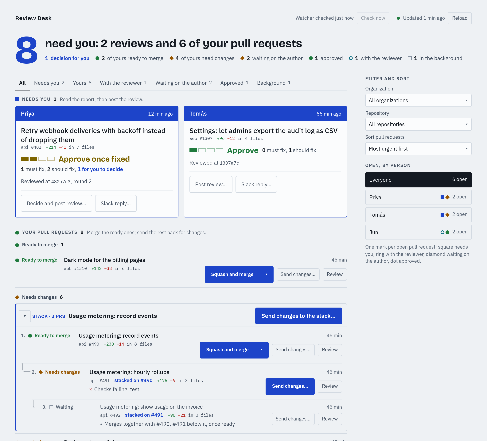

# Review Desk

A pull-request desk where agents prepare every review, fix and merge, and nothing goes out under your name until
you say so.

Review Desk isn't an app you install. It's a **recipe** your own coding agent builds from, shaped to your people,
your repos, your chat and your agent harness. It can run inside the harness as scheduled tasks, or as a small
service on a machine that's always on.



<sub>The working setup's page, with made-up people and repos.</sub>

## What it does

**Reviews people ask you for.** Review Desk notices when someone requests your review on GitHub, or asks in a chat
DM. Once the PR is ready (CI green, no conflicts, not a draft), a locked-down reviewer agent reads it and drafts
your review: a verdict, what must be fixed, what should be fixed, and the calls only you can make. The reviewer
can't run commands, write files or post anything, because everything it reads was written by someone else. On one
page you see each PR's verdict, answer its questions, and post the review, and a short chat reply, as you, with one
press each.

**Your own pull requests.** Every open PR you authored is sorted into *Ready to merge*, *Needs changes* (with why:
conflicts, failing checks, changes requested, unanswered review-bot threads, behind its base), *In progress* and
*Waiting*. You merge with one press, update a branch, or send change requests to the agent thread that opened the
PR. Stacked PRs and multi-PR features show as one card, in merge order, and one agent can merge or fix the whole
stack.

**Optional:** automatic first passes, where the review posts to the author, clearly labelled, before you read it,
until nothing must be fixed. And agents on the page: an agent in your browser can drive the page, and it asks you
before anything that acts as you.

## Use it

Install the skill, then ask your agent to build one:

```
npx skills add mikeallisonJS/review-desk
```

> Build me a Review Desk with the review-desk skill.

Or point your agent at [`skills/review-desk/RECIPE.md`](skills/review-desk/RECIPE.md) directly. The skill
interviews you first (who may ask for reviews, which repos, which chat, where it runs), then builds in stages that
are each useful on their own, checking each one before going on.

To update a build later, update the skill and run it again. It reads [`CHANGELOG.md`](skills/review-desk/CHANGELOG.md)
from the version your build records, and offers what's new.

## What's here

| Path | What |
|---|---|
| `skills/review-desk/SKILL.md` | How an agent runs the interview and the build, or an update |
| `skills/review-desk/RECIPE.md` | What to build: invariants, architecture, every behaviour and why it's that way, GitHub gotchas, build order and checks |
| `skills/review-desk/CHANGELOG.md` | What changed, by version (a date) |
| `skills/review-desk/templates/` | The reviewer's instructions and lockdown, and the prompts for the watcher, chat relay and fix dispatcher |

## Where it comes from

Review Desk is published from a working setup that runs every day, and this repo is updated when that setup
changes. Issues are welcome. Pull requests are read, then ported into the source by hand.

## License

MIT. See `LICENSE`.
